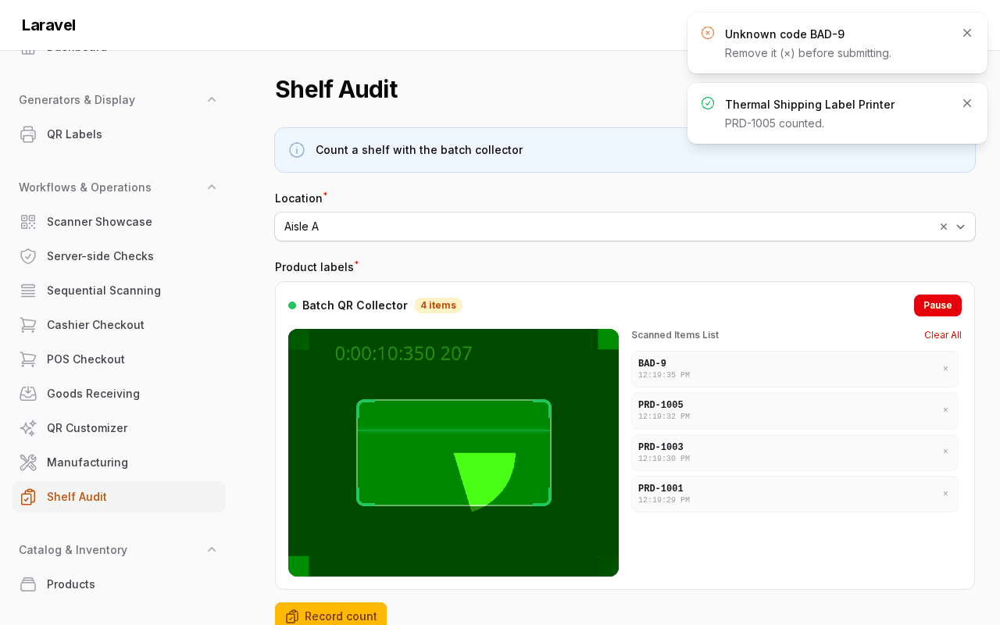
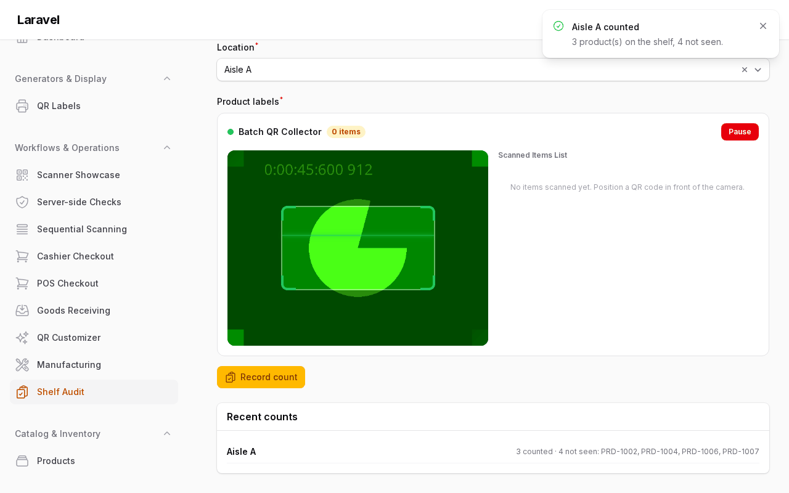

# Batch Collecting

> Back to [README](../README.md) · [Scanning](scanning.md) · [Generating](generating.md) · [Reference](reference.md)

Continuous camera multi-scan for inventory and repeater flows. For cashier/POS gun flows, see the [POS tutorial](scanning.md#tutorial-cashier-pos-with-a-handheld-scanner).

## Batch Collector Scanning (`QrCollector`, `QrCollectAction`)



*A warehouse shelf audit: each wedge or camera scan is looked up against seeded products, repeats are ignored, and unknown codes are flagged so they can be removed (×) before submitting.*



*After "Record count" the collector clears and the count shows which products were not seen.*

See the full example app: [`app/Filament/Pages/ShelfAudit.php`](https://github.com/mmuqiitf/filament-qr-code-example/blob/main/app/Filament/Pages/ShelfAudit.php).

### In Form Repeaters

```php
use Mmuqiitf\FilamentQrCode\Enums\BarcodeFormat;
use Mmuqiitf\FilamentQrCode\Forms\Components\QrCollector;

QrCollector::make('scanned_items')
    ->allowDuplicates(false)
    ->delayBetweenScans(1200)
    ->formats([BarcodeFormat::QrCode, BarcodeFormat::Code128])
    ->preferRearCamera();
```

### As a Table / Repeater Action

```php
use Mmuqiitf\FilamentQrCode\Enums\BarcodeFormat;
use Mmuqiitf\FilamentQrCode\Tables\Actions\QrCollectAction;

$table->headerActions([
    QrCollectAction::make()
        ->allowDuplicates(false)
        ->formats([BarcodeFormat::QrCode, BarcodeFormat::Code128])
        ->onScan(fn ($code) => logger()->info("Collected {$code}")),
]);
```

Each scan notifies the server through exactly one channel: `$wire.handleCollectorScan($code)` when the host Livewire component defines it, otherwise a `qr-collector-item-added` window event (with `{ code }`) that the host forwards — e.g. `x-on:qr-collector-item-added.window` calling your Livewire method, which can then invoke `$action->handleScan($code)` to run the `onScan` callback. The component picks deterministically, so a scan is never handled twice.

Every `handleScan()` call also fires a `QrCodeScanned` event — see [Audit scans](customizing.md#audit-scans).

Custom terminators and minimum lengths are configurable via `->hardwareScanner(terminators: [...], minBarcodeLength: 3)` and feedback pitch/duration via `->beepFrequency(660)`, `->beepDuration(120)`, `->vibrateDuration(200)`. Server-side, `->distinctItems()` rejects duplicate codes on submit to match `->allowDuplicates(false)` in the browser.

`->itemRules()` runs Laravel validation rules on each code before the browser adds it, and again when the field is submitted. The first failing code fails the field. An empty list accepts every code. The collect action modal does not run these rules: it is not a schema field, so keep that check on `QrCollector`.

```php
use Mmuqiitf\FilamentQrCode\Forms\Components\QrCollector;

QrCollector::make('scanned_items')
    ->itemRules(['regex:/^PRD-\d+$/']);
```

`->normalizeWith()` is the same as on a scanner or sequence: trim (on by default), optional uppercase, and optional prefix stripping run in the browser before duplicate detection and again on the server before GS1 checks and `itemRules()`.

```php
use Mmuqiitf\FilamentQrCode\Forms\Components\QrCollector;

QrCollector::make('scanned_items')
    ->normalizeWith(uppercase: true, stripPrefix: [']C1', ']Q1'])
    ->itemRules(['regex:/^SKU-/']);
```

`->gs1(require: ['01', '17'])` treats every item as a GS1 label: the list stores the normalized bracketed string, and an invalid or incomplete label is rejected before it is added. There is no `fill` — use `QrScanner` or a [sequence step](gs1.md#scanning-gs1-labels) to write AIs into sibling fields. `itemRules` run after the GS1 check and see the bracketed string. The collect action modal does not run `gs1()`. See [Scanning GS1 labels](gs1.md#scanning-gs1-labels).
