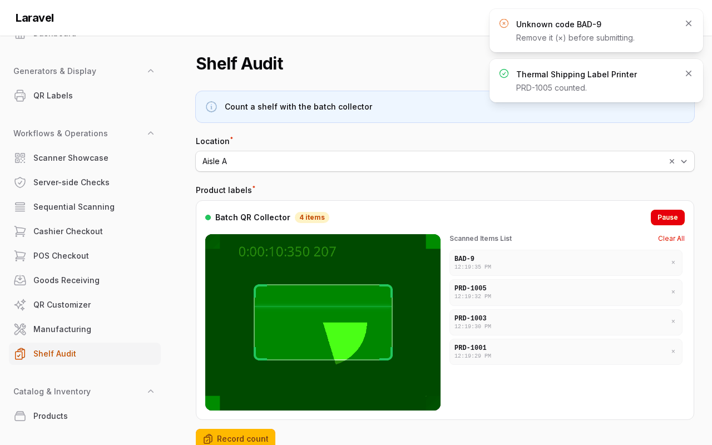
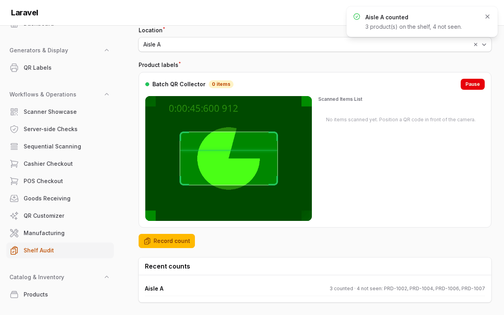

# Batch Collecting

> Back to [README](../README.md) · [Scanning](scanning.md) · [Generating](generating.md) · [Reference](reference.md)

Continuous camera multi-scan for inventory and repeater flows. For cashier/POS gun flows, see the [POS tutorial](scanning.md#tutorial-cashier-pos-with-a-handheld-scanner).

## Batch Collector Scanning (`QrCollector`, `QrCollectAction`)



*A warehouse shelf audit: each wedge or camera scan is looked up against seeded products, repeats are ignored, and unknown codes are flagged so they can be removed (×) before submitting.*



*After "Record count" the collector clears and the count shows which products were not seen.*

See the full example app: [`app/Filament/Pages/ShelfAudit.php`](https://github.com/mmuqiitf/filament-qr-code-example/blob/main/app/Filament/Pages/ShelfAudit.php).

### In Form Repeaters

```php
use Mmuqiitf\FilamentQrCode\Enums\BarcodeFormat;
use Mmuqiitf\FilamentQrCode\Forms\Components\QrCollector;

QrCollector::make('scanned_items')
    ->allowDuplicates(false)
    ->delayBetweenScans(1200)
    ->formats([BarcodeFormat::QrCode, BarcodeFormat::Code128])
    ->preferRearCamera();
```

### As a Table / Repeater Action

```php
use Mmuqiitf\FilamentQrCode\Enums\BarcodeFormat;
use Mmuqiitf\FilamentQrCode\Tables\Actions\QrCollectAction;

$table->headerActions([
    QrCollectAction::make()
        ->allowDuplicates(false)
        ->formats([BarcodeFormat::QrCode, BarcodeFormat::Code128])
        ->onScan(fn ($code) => logger()->info("Collected {$code}")),
]);
```

Each scan notifies the server through exactly one channel: `$wire.handleCollectorScan($code)` when the host Livewire component defines it, otherwise a `qr-collector-item-added` window event (with `{ code }`) that the host forwards — e.g. `x-on:qr-collector-item-added.window` calling your Livewire method, which can then invoke `$action->handleScan($code)` to run the `onScan` callback. The component picks deterministically, so a scan is never handled twice.

Every `handleScan()` call also fires a `QrCodeScanned` event — see [Audit scans](customizing.md#audit-scans).

Custom terminators and minimum lengths are configurable via `->hardwareScanner(terminators: [...], minBarcodeLength: 3)` and feedback pitch/duration via `->beepFrequency(660)`, `->beepDuration(120)`, `->vibrateDuration(200)`. Server-side, `->distinctItems()` rejects duplicate codes on submit to match `->allowDuplicates(false)` in the browser.
