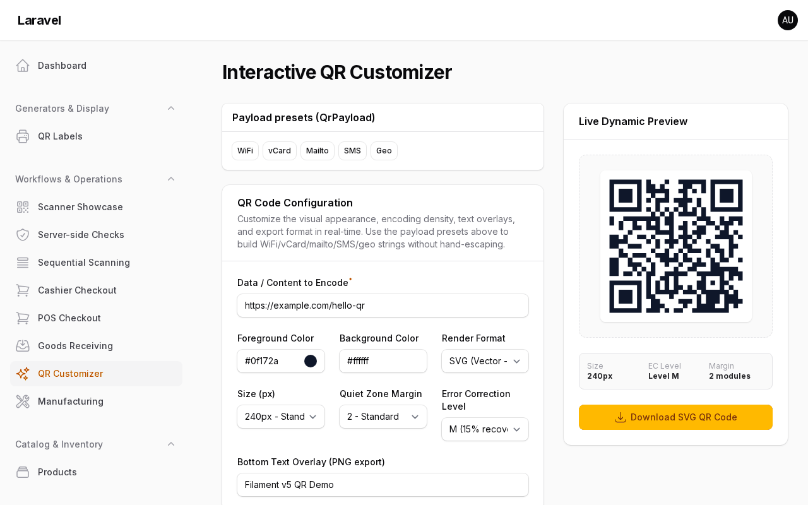
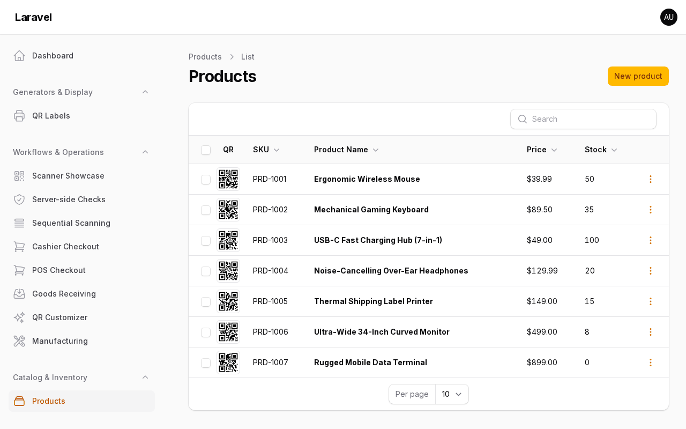
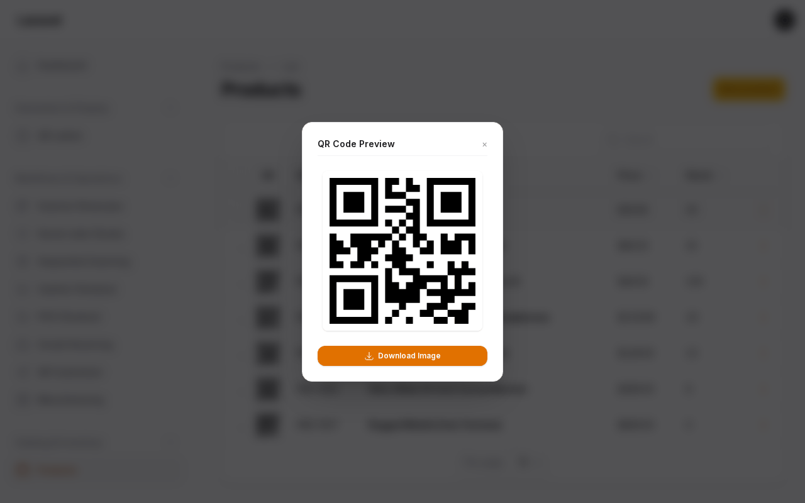
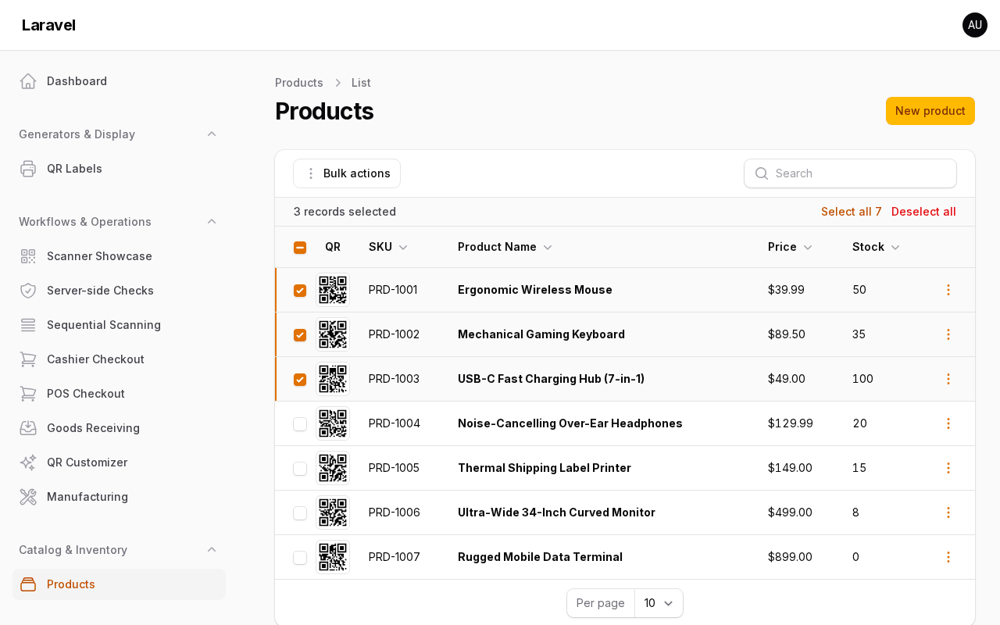

# Generating QR Codes

> Back to [README](../README.md) · [Scanning](scanning.md) · [Batch collecting](collecting.md) · [Reference](reference.md)

Render QR codes in forms, tables, and infolists, offer downloads and bulk ZIP exports, or generate standalone via the facade.

## QR Generator components



*Live preview of colours, size, margin and error correction.* See the full example app: [`app/Filament/Pages/QrCustomizer.php`](https://github.com/mmuqiitf/filament-qr-code-example/blob/main/app/Filament/Pages/QrCustomizer.php).

### In Form Schemas

```php
use Mmuqiitf\FilamentQrCode\Forms\Components\QrCodeDisplay;

QrCodeDisplay::make('qr')
    ->data(fn ($record) => $record?->uuid)
    ->size(200)
    ->color('#1e293b')
    ->caption('Scan to verify')
    ->downloadable();
```

### In Table Columns



*A QR column in a Filament table.* See the full example app: [`app/Filament/Resources/Products/Tables/ProductsTable.php`](https://github.com/mmuqiitf/filament-qr-code-example/blob/main/app/Filament/Resources/Products/Tables/ProductsTable.php).



*Clicking a QR opens the preview modal with download.* See the full example app: [`app/Filament/Resources/Products/Tables/ProductsTable.php`](https://github.com/mmuqiitf/filament-qr-code-example/blob/main/app/Filament/Resources/Products/Tables/ProductsTable.php).

```php
use Mmuqiitf\FilamentQrCode\Tables\Columns\QrColumn;

QrColumn::make('sku')
    ->thumbnailSize(48)
    ->modalSize(300)
    ->previewable()
    ->downloadable();
```

A previewable column owns its click: the thumbnail opens the preview instead of following the table's `recordUrl()`, which still applies to the other cells. With `->previewable(false)` the thumbnail links to the record like any other column.

Thumbnails and modal previews share a capped in-process render cache (clear it with `QrColumn::flushDataUriCache()`, for example between tests or in long-running workers) plus a persistent Laravel-cache L2 (`generator.cache_ttl`, default 86400s: an int is seconds, `null` keeps entries forever, `false` turns the L2 off while the in-process cache keeps working; `QrCodeService::persistentCache(false)` / `::cacheStore('redis')` to tune). The modal image loads lazily through a signed `filamentQrCode.image` route, so a 25-row table encodes 25 thumbnails instead of 50 mixed-size images — `->lazyModal(false)` restores eager data-URIs. The signed URL carries the full render spec (colors, error correction, logo, caption), so lazy previews match the inline renders exactly.

#### Image route security

The signed `filamentQrCode.image` route is safe by default (signatures stop tampering), and 1.0.1 adds opt-in hardening for apps where QR data or logo paths come from users. Every key is off by default, so upgrading changes nothing until you set one:

```php
// config/qr-code.php
'generator' => [
    // ...
    'logo_base_paths' => [storage_path('app/qr-logos')],
],
'image_route' => [
    'ttl' => 60,             // preview URLs expire after an hour
    'throttle' => '60,1',    // 60 images per minute per client, then 429
    'strict_colors' => true, // #rrggbb only, else 422
],
```

- `logo_base_paths` resolves each logo with `realpath()` (so `../` and symlinks that escape are caught) and accepts only PNG, JPEG, GIF or WebP files inside a listed directory. Inline renders (columns, entries, downloads, `QrCodeService`) skip a rejected logo and log a warning; the image route answers 422.
- `ttl` signs preview URLs with an `expires` parameter (expired links get 403) and caps the browser cache at the TTL.
- `qr-code:doctor` reports whether logos are restricted and flags base paths that do not exist.

### In Infolists

```php
use Mmuqiitf\FilamentQrCode\Infolists\Components\QrEntry;

QrEntry::make('verification_code')
    ->size(200)
    ->caption('Official Verification QR');
```

### As a Download Action

```php
use Mmuqiitf\FilamentQrCode\Enums\QrFormat;
use Mmuqiitf\FilamentQrCode\Tables\Actions\DownloadQrAction;

$table->actions([
    DownloadQrAction::make()
        ->qrData(fn ($record) => $record->verification_url)
        ->qrFileName(fn ($record) => "qr-{$record->id}")
        ->qrFormat(QrFormat::Png)
        ->qrImageSize(400)
        ->qrMargin(2),
]);
```

Both download actions share one render spec and default to black on white. Opt into the full surface to match a styled display — `->qrColor()`, `->qrBackgroundColor()`, `->qrErrorCorrection()`, `->qrLogo($path)`, `->qrCaption()` — and bulk filenames follow forced-PNG output (a logo or caption rasterizes) in their extension.

### As a Bulk ZIP Export



*Select rows, then export their QR codes as one ZIP.* See the full example app: [`app/Filament/Resources/Products/Tables/ProductsTable.php`](https://github.com/mmuqiitf/filament-qr-code-example/blob/main/app/Filament/Resources/Products/Tables/ProductsTable.php).

```php
use Mmuqiitf\FilamentQrCode\Enums\QrFormat;
use Mmuqiitf\FilamentQrCode\Tables\Actions\DownloadQrBulkAction;

$table->bulkActions([
    DownloadQrBulkAction::make()
        ->qrData('sku') // attribute name, or fn ($record) => ...
        ->qrFileName(fn ($record) => $record->sku)
        ->qrFormat(QrFormat::Png)
        ->zipName('shelf-labels.zip'),
]);
```

Rows without data are skipped; the archive downloads as one ZIP (needs the PHP `zip` extension). For printed shelf labels, wrap any QR images in `.filament-qr-label-sheet` / `.filament-qr-label` — the print stylesheet hides camera UI and tiles three labels per row.

To test the export or reuse the renders elsewhere, `recordsToFiles(Collection $records): array` returns the same files without zipping: file name with extension => raw image bytes.

### Programmatic Standalone Generation

```php
use Mmuqiitf\FilamentQrCode\Facades\FilamentQrCode;
use Mmuqiitf\FilamentQrCode\Enums\QrFormat;

// Generate data URI
$dataUri = FilamentQrCode::make()
    ->format(QrFormat::Svg)
    ->size(300)
    ->margin(2)
    ->color('#0f172a')
    ->backgroundColor('#ffffff')
    ->errorCorrection('M') // L, M, Q, H
    ->generate('https://example.com')
    ->toDataUri();

// Generate PNG with Text Overlay & Download
return FilamentQrCode::make()
    ->withText('BATCH #1024', 16, '#000000')
    ->generate('BATCH-1024')
    ->download('batch-1024'); // StreamedResponse download; stream() inlines
```

Rules that bite:

- `withText()` and `logo()` need raster output, so the service always returns PNG when either is set — regardless of whether `format()` was called before or after. Request PNG explicitly when overlaying.
- Invalid hex colors throw `InvalidArgumentException` instead of silently rendering black.
- `logo($path, $size)` forces error-correction level H for scannability.
- Identical payloads share the render cache, so tables with repeated values encode once.
- Other builder methods: `font($path)` sets the TTF used by `withText()`, `fileName($name)` sets the default download name (no extension), and `getRaw()` returns the encoded bytes.
- Static cache helpers on `QrCodeService`: `persistentCache(bool)`, `cacheStore(?string)`, `cacheTtl(int|false|null $seconds)` (overrides `generator.cache_ttl`; `null` clears the override) and `effectiveCacheTtl()` (the value in effect), `flushRenderCache()` (in-process) and `flushPersistentCache()` (Laravel cache).

### Common payloads without hand-escaping

```php
use Mmuqiitf\FilamentQrCode\Support\QrPayload;

QrPayload::wifi('Shop Floor', 'secret-1');                    // WPA (nopass + hidden supported)
QrPayload::vcard(['firstName' => 'Siti', 'phone' => '...']);   // escaped vCard 3.0
QrPayload::mailto('ops@example.com', 'Stock alert', '...');   // mailto with subject/body
QrPayload::sms('+621234567', 'Arrived');                     // SMSTO
QrPayload::geo(-6.2, 106.8, 'Warehouse 7');                   // geo with query
```
