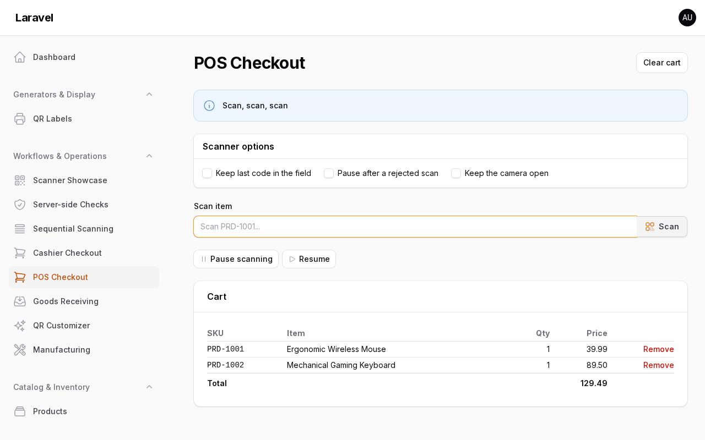

# Recipe: POS checkout with continuous scanning

A cashier page where a handheld scanner (keyboard wedge) or the camera adds products to a cart, one line per SKU, without touching the mouse.

Runs in the example app: `/admin/pos-checkout` (`app/Filament/Pages/PosCheckout.php`).

## The form

```php
use Filament\Forms\Components\Repeater;
use Filament\Forms\Components\TextInput;
use Filament\Schemas\Components\Utilities\Get;
use Filament\Schemas\Components\Utilities\Set;
use Mmuqiitf\FilamentQrCode\Enums\ContinuousDisplay;
use Mmuqiitf\FilamentQrCode\Enums\HardwareInputScope;
use Mmuqiitf\FilamentQrCode\Enums\ScanMode;
use Mmuqiitf\FilamentQrCode\Forms\Components\QrScanner;

QrScanner::make('scan')
    ->label('Scan item')
    ->mode(ScanMode::Continuous)
    ->hardwareInput(scope: HardwareInputScope::Page)
    ->normalizeWith(uppercase: true)            // a handheld set to lower case still matches
    ->lookup(Product::class, 'sku')
    ->onScanned(function (Product $record, Get $get, Set $set): void {
        $set('lines', CartLines::add($get('lines') ?? [], $record));
    })
    // Page switches: options follow the server on every re-render.
    ->continuousDisplay(fn (): ContinuousDisplay => $this->keepLastCode ? ContinuousDisplay::LastCode : ContinuousDisplay::Empty)
    ->pauseOnReject(fn (): bool => $this->pauseOnReject)
    ->keepCameraOpen(fn (): bool => $this->keepCameraOpen)
    ->dehydrated(false),

Repeater::make('lines')
    ->schema([
        TextInput::make('sku')->disabled(),
        TextInput::make('name')->disabled(),
        TextInput::make('quantity')->numeric()->minValue(1),
    ])
    ->addable(false),
```

Toggle `keepLastCode`, `pauseOnReject` or `keepCameraOpen` with `wire:model.live` checkboxes and the scanner picks up the new options in place: the camera, a queued scan and the field state all survive. Don't wrap the form in a changing `wire:key`; that re-creates the scanner and was only needed before 0.6.

## Merging lines

The package calls `onScanned()` once per accepted code; merging is the app's job:

```php
final class CartLines
{
    /** @param array<int|string, array{sku: string, name: string, quantity: int}> $lines */
    public static function add(array $lines, Product $product): array
    {
        foreach ($lines as $key => $line) {
            if ($line['sku'] === $product->sku) {
                $lines[$key]['quantity']++;

                return $lines;
            }
        }

        $lines[] = ['sku' => $product->sku, 'name' => $product->name, 'quantity' => 1];

        return $lines;
    }
}
```

## Pause and resume buttons

Window events reach the scanner by its state path, field name or component key:

```blade
<x-filament::button color="gray" x-on:click="$dispatch('qr-scanner-pause', { field: 'data.scan' })">Pause scanning</x-filament::button>
<x-filament::button color="gray" x-on:click="$dispatch('qr-scanner-resume', { field: 'data.scan' })">Resume</x-filament::button>
```

From PHP, `$this->dispatch('qr-scanner-pause', field: 'data.scan')` does the same.

## How it behaves



*Scanned SKUs land as line items with live totals.* See the full example app: [`app/Filament/Pages/PosCheckout.php`](https://github.com/mmuqiitf/filament-qr-code-example/blob/main/app/Filament/Pages/PosCheckout.php).

- **Page scope**: with nothing focused, a wedge scan goes to the first listening field on the page, here the scan field. A focused scan field always wins, so another scanner on the page still works when the cashier clicks into it.
- **Empty after each scan** (`continuousDisplay`, default `Empty`): the field is ready for the next item.
- **Unknown code**: the lookup rejects it, the error tone plays and the message shows under the field. Scanning continues (`pauseOnReject()` to stop until the cashier confirms).
- **Camera**: closes after each scan by default; `keepCameraOpen()` for scan-scan-scan with a phone.
- **Same item twice**: two lines merge into quantity 2. Scans of the same code closer than 300 ms are treated as a camera re-read and ignored (`qr-code.scan.continuous.cooldown_ms`). `normalizeWith()` runs first, so `prd-1001` and `PRD-1001` count as the same code.
- **Fast bursts**: one scan is queued while the previous one is checked; more fire `qr-scan-dropped`.

Defaults for all of this live in `config/qr-code.php` under `scan.continuous`.
